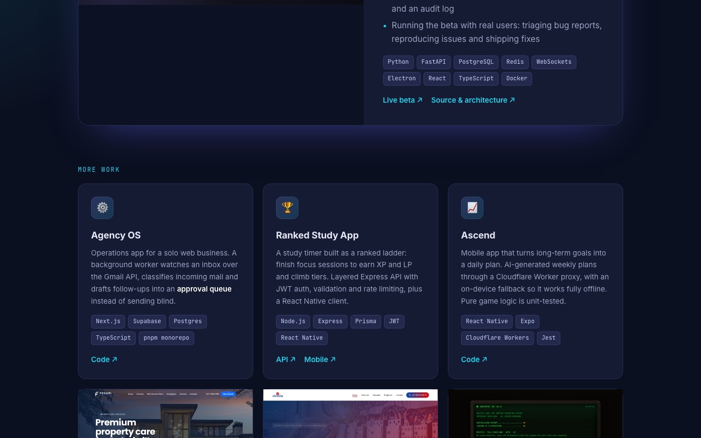

# Konstantinos Kolta — Portfolio

My personal portfolio site, built by hand with **HTML, CSS and vanilla JavaScript**. No framework and no build step.

**Live:** https://shasuani.github.io/portfolio-website/



## Features

- Dark, responsive design built with CSS Grid and Flexbox, from 320px phones to wide desktops
- Featured project section plus a project grid with live-site screenshots
- Scroll-reveal animations with `IntersectionObserver`, disabled under `prefers-reduced-motion`
- Accessibility: skip link, visible focus states, semantic landmarks and alt text
- SEO: meta description, Open Graph tags and `schema.org` Person JSON-LD
- Deployed with GitHub Pages straight from `main`

## Run locally

```bash
git clone https://github.com/Shasuani/portfolio-website.git
cd portfolio-website
open index.html
```
